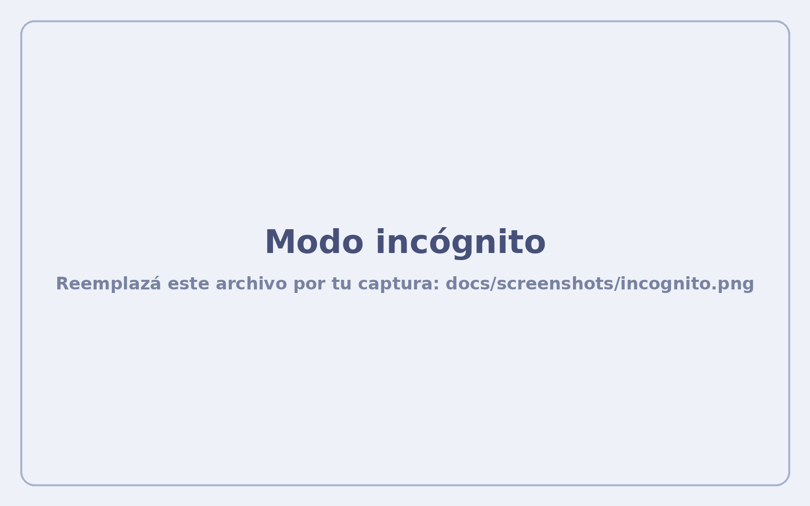
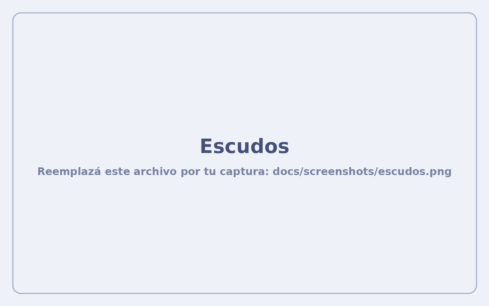

<p align="center">
  
</p>

<h1 align="center">Navegador</h1>

<p align="center">
  Un navegador web nativo para Windows, liviano, con escudos de privacidad y diseño inspirado en Safari.<br>
  Hecho con <b>WinUI 3</b> + <b>WebView2</b> (.NET 8).
</p>

<p align="center">
  
</p>

## Características

- **Interfaz tipo Safari:** fondo translúcido (Mica), barra de direcciones en píldora centrada que muestra solo el dominio, botones planos y barra de progreso fina.
- **Pestañas integradas en la barra de título**, con atajos de teclado.
- **Modo incógnito:** perfil temporal aislado que se borra al cerrar la última pestaña y no guarda historial.
- **Descargas:** pestaña propia con progreso y un selector para elegir dónde guardar cada archivo.
- **Escudos estilo Brave:** bloqueo de anuncios y rastreadores, HTTPS automático, limpieza de parámetros de seguimiento (`utm_*`, `fbclid`, `gclid`...), señales GPC/DNT, prevención de seguimiento y apagado por sitio.
- **Historial y marcadores** guardados en local.
- **Importar desde Google Chrome:** marcadores e historial.
- **Buscador a elección:** Google, DuckDuckGo, Brave Search o Bing.

## Capturas

| Modo incógnito | Descargas |
| :---: | :---: |
|  |  |

| Escudos por sitio | Configuración |
| :---: | :---: |
|  |  |

## Atajos de teclado

Funcionan cuando el foco está en la barra de herramientas (no dentro de la página).

| Atajo | Acción |
| --- | --- |
| `Ctrl` + `T` | Nueva pestaña |
| `Ctrl` + `Shift` + `N` | Nueva pestaña de incógnito |
| `Ctrl` + `W` | Cerrar pestaña |
| `Ctrl` + `L` | Ir a la barra de direcciones |
| `Ctrl` + `D` | Agregar o quitar marcador |
| `Ctrl` + `H` | Historial |
| `Ctrl` + `J` | Descargas |
| `F5` | Recargar |

## Descargar y compilar

### Con GitHub Actions

El repositorio compila solo en un runner de Windows:

1. Subí un `.zip` con el proyecto a la raíz del repo. El workflow `unzip.yml` lo descomprime, lo borra y hace el commit.
2. Después corre `build.yml`, que publica la app (self-contained, x64).
3. El resultado queda como artefacto **Navegador-win-x64** en la pestaña *Actions*.

Cualquier cambio dentro de `Navegador/` también dispara la compilación, y se puede lanzar a mano con *Run workflow*.

### En tu PC

Requisitos: Windows 10 (1809) o superior y el SDK de .NET 8.

```powershell
dotnet publish Navegador/Navegador.csproj -c Release -r win-x64 -p:Platform=x64 -o publish
```

El ejecutable queda en `publish/Navegador.exe`.

## Estructura

```
Navegador/
├─ MainWindow.xaml(.cs)      Ventana, pestañas, barra de direcciones y escudos
├─ BrowserTab.cs             Modelo de pestaña (web o página interna)
├─ Models/                   Marcadores, historial y descargas
├─ Services/                 Adblock, perfiles, ajustes, historial, importador de Chrome
├─ Views/                    Descargas, historial, marcadores y configuración
└─ Assets/icon.ico           Ícono de la app
scripts/screenshots.ps1      Toma las capturas de pantalla de la app
docs/                        Ícono y capturas usados en este README
.github/workflows/
├─ unzip.yml                 Descomprime el .zip subido a la raíz
├─ build.yml                 Compila y sube el artefacto
└─ screenshots.yml           Genera las capturas y las guarda en docs/screenshots
```

## Limitaciones actuales

- El bloqueo de anuncios es por dominio: no oculta elementos de las páginas ni frena anuncios servidos desde el dominio del propio sitio.
- Del importador de Chrome faltan contraseñas, cookies y extensiones.
- No hay sincronización de cuenta de Google.
- La lista de descargas solo vive mientras la app está abierta.

## Capturas automáticas

Las imágenes de `docs/screenshots/` las genera solo el workflow **Capturas de pantalla** (`screenshots.yml`):

1. Compila la app en un runner de Windows.
2. Ejecuta `scripts/screenshots.ps1`, que abre la app con distintos argumentos y guarda una captura de su ventana por escenario.
3. Hace commit de los PNG en `docs/screenshots/`.

Corre después de cada compilación que sale de un `.zip` subido al repo, y también a mano desde *Actions → Capturas de pantalla → Run workflow*.
Si una captura sale vacía, el script la descarta y se conserva la imagen anterior.

Argumentos de línea de comandos de la app (sirven para las capturas, pero se pueden usar siempre):

| Argumento | Efecto |
| --- | --- |
| `--url=https://...` | Abre esa dirección en la primera pestaña |
| `--incognito` | La primera pestaña es de incógnito |
| `--open=settings` | Abre una página interna: `settings`, `downloads`, `history` o `bookmarks` |
| `--size=1100x720` | Tamaño de la ventana en píxeles |
| `--demo-shields` | Abre el panel de escudos a los pocos segundos |
