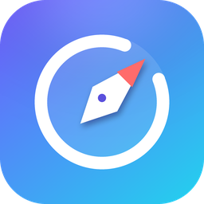
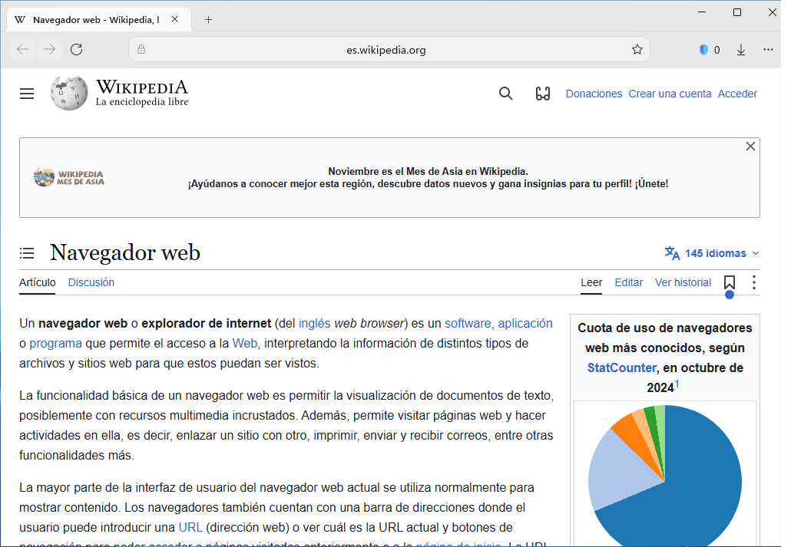
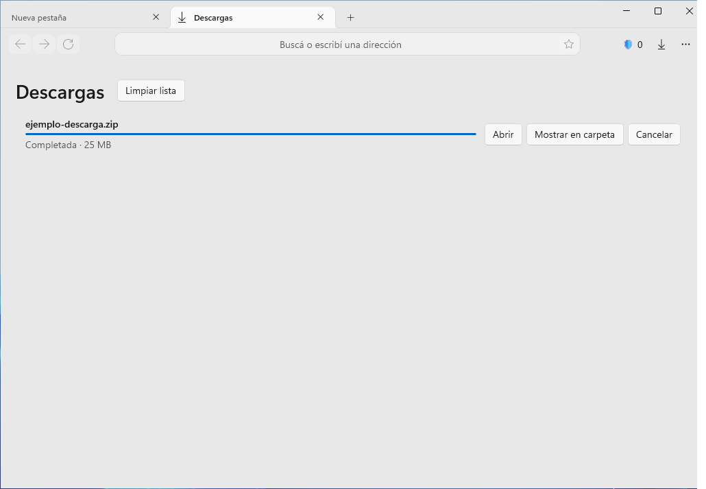
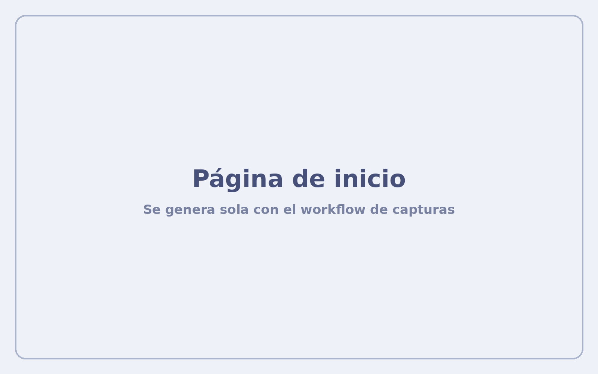
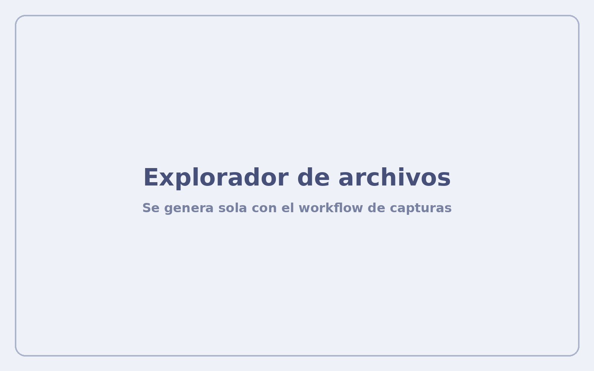
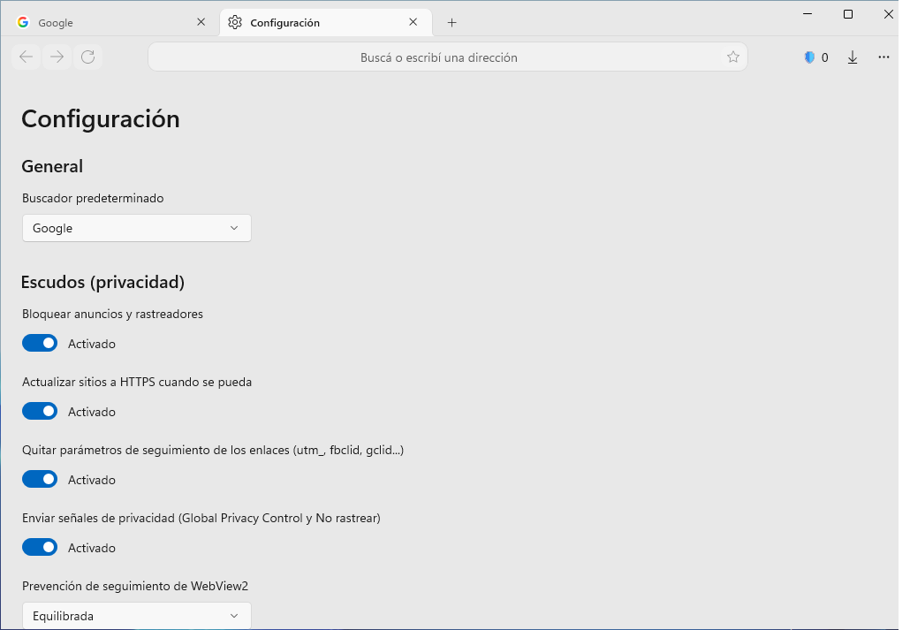

<p align="center">
  
</p>

<h1 align="center">Navegador</h1>

<p align="center">
  Un navegador web nativo para Windows, liviano, con escudos de privacidad y diseño inspirado en Safari.<br>
  Hecho con <b>WinUI 3</b> + <b>WebView2</b> (.NET 8).
</p>

<p align="center">
  
</p>

## Características

- **Interfaz tipo Safari:** fondo translúcido (Mica), barra de direcciones en píldora centrada que muestra solo el dominio, botones planos y barra de progreso fina.
- **Pestañas integradas en la barra de título**, con atajos de teclado que funcionan también dentro de la página. Menú por pestaña (duplicar, silenciar, cerrar las demás), indicador de sonido, reabrir la última cerrada y restaurar las pestañas al abrir.
- **Página de inicio** con buscador y favoritos, **barra de marcadores** y **sugerencias** en la barra de direcciones (marcadores, historial y búsqueda).
- **Buscar en la página**, zoom por sitio, imprimir, guardar como PDF, herramientas de desarrollo y pantalla completa (también para videos).
- **Permisos por sitio** (cámara, micrófono, ubicación, notificaciones) con una lista para revisarlos, y **ahorro de memoria** que suspende las pestañas sin uso.
- **Tirador en forma de gota** pegado al borde izquierdo para abrir y cerrar el explorador de archivos.
- **Instalador** (`Navegador-Setup.exe`) generado por GitHub Actions, sin permisos de administrador, y registro para aparecer en la lista de navegadores de Windows.
- **Modo incógnito:** perfil temporal aislado que se borra al cerrar la última pestaña y no guarda historial.
- **Descargas:** pestaña propia con progreso y un selector para elegir dónde guardar cada archivo. La lista se guarda entre sesiones.
- **Escudos estilo Brave:** bloqueo de anuncios y rastreadores con listas EasyList, EasyPrivacy y EasyList Spanish (reglas de red y ocultamiento de elementos), HTTPS automático, limpieza de parámetros de seguimiento (`utm_*`, `fbclid`, `gclid`...), señales GPC/DNT, prevención de seguimiento y apagado por sitio.
- **Explorador de archivos en un cajón lateral** (Ctrl+E), portado de AlternAIs: pestañas propias dentro del explorador, lugares rápidos y unidades, miniaturas de imágenes, selección múltiple con casillas, copiar, mover y pegar, renombrar, carpeta nueva, borrar a la Papelera de reciclaje, y ver por dentro, extraer y modificar `.zip` (los `.rar` se ven y se extraen). Los archivos que el navegador sabe mostrar se pueden abrir en una pestaña.
- **Historial y marcadores** guardados en local.
- **Importar desde Google Chrome:** marcadores e historial.
- **Buscador a elección:** Google, DuckDuckGo, Brave Search o Bing.

## Capturas

| Modo incógnito | Descargas |
| :---: | :---: |
|  |  |

| Página de inicio | Explorador de archivos |
| :---: | :---: |
|  |  |

| Escudos por sitio | Configuración |
| :---: | :---: |
|  |  |

## Atajos de teclado

Funcionan con el foco en la barra y también dentro de la página.

| Atajo | Acción |
| --- | --- |
| `Ctrl` + `T` | Nueva pestaña |
| `Ctrl` + `Shift` + `N` | Nueva pestaña de incógnito |
| `Ctrl` + `W` | Cerrar pestaña |
| `Ctrl` + `L` | Ir a la barra de direcciones |
| `Ctrl` + `D` | Agregar o quitar marcador |
| `Ctrl` + `H` | Historial |
| `Ctrl` + `J` | Descargas |
| `Ctrl` + `E` | Explorador de archivos (cajón lateral) |
| `Ctrl` + `F` | Buscar en la página |
| `Ctrl` + `P` | Imprimir |
| `Ctrl` + `Mayús` + `T` | Reabrir la última pestaña cerrada |
| `Ctrl` + `Mayús` + `B` | Mostrar u ocultar la barra de marcadores |
| `Ctrl` + `Tab` / `Ctrl` + `Mayús` + `Tab` | Pestaña siguiente / anterior |
| `Ctrl` + `1` … `9` | Ir a la pestaña número 1 … 9 (la 9 es la última) |
| `Ctrl` + `+` / `-` / `0` | Acercar, alejar y restablecer el zoom (también `Ctrl` + rueda) |
| `F11` / `F12` | Pantalla completa / herramientas de desarrollo |
| `Supr` / `F2` / `Enter` / `Retroceso` | En el explorador: borrar, renombrar, abrir, subir de carpeta |
| `Ctrl` + `C` / `X` / `V` / `A` | En el explorador: copiar, mover, pegar, seleccionar todo |
| `Ctrl` + `Mayús` + `N` | En el explorador: carpeta nueva |
| `F5` | Recargar |

## Descargar y compilar

### Con GitHub Actions

El repositorio compila solo en un runner de Windows:

1. Subí un `.zip` con el proyecto a la raíz del repo. El workflow `unzip.yml` lo descomprime, lo borra y hace el commit.
2. Después corre `build.yml`, que publica la app (self-contained, x64).
3. El resultado queda como artefacto **Navegador-win-x64** en la pestaña *Actions*.

Cualquier cambio dentro de `Navegador/` también dispara la compilación, y se puede lanzar a mano con *Run workflow*.

### En tu PC

Requisitos: Windows 10 (1809) o superior y el SDK de .NET 8.

```powershell
dotnet publish Navegador/Navegador.csproj -c Release -r win-x64 -p:Platform=x64 -o publish
```

El ejecutable queda en `publish/Navegador.exe`.

## Estructura

```
Navegador/
├─ MainWindow.xaml(.cs)      Ventana, pestañas, barra de direcciones y escudos
├─ MainWindow.Features.cs    Búsqueda, zoom, sesión, sugerencias, marcadores, permisos y más
├─ BrowserTab.cs             Modelo de pestaña (web o página interna)
├─ Models/                   Marcadores, historial y descargas
├─ Services/                 Adblock, perfiles, ajustes, historial, importador de Chrome
├─ Views/                    Descargas, historial, marcadores, configuración y el cajón del explorador
├─ Files/                    Operaciones de archivos y comprimidos (copiar, mover, extraer .zip/.rar)
├─ Ui/ · Platform/           Pestañas, diálogos e íconos del explorador; envío a la Papelera
└─ Assets/icon.ico           Ícono de la app
scripts/screenshots.ps1      Toma las capturas de pantalla de la app
installer/navegador.iss      Script del instalador (Inno Setup)
docs/                        Ícono y capturas usados en este README
.github/workflows/
├─ unzip.yml                 Descomprime el .zip subido a la raíz
├─ build.yml                 Compila, sube el artefacto y crea el instalador
└─ screenshots.yml           Genera las capturas y las guarda en docs/screenshots
```

## Limitaciones actuales

- No hay extensiones: WebView2 no instala las de la Chrome Web Store.
- No hay gestor de contraseñas propio ni sincronización entre dispositivos (Google no ofrece una API pública para Chrome Sync).
- El bloqueo cubre reglas de red y ocultamiento de elementos de las listas de filtros; no incluye reglas con expresiones regulares ni filtros avanzados (por ejemplo, los anuncios de video de YouTube).
- Del importador de Chrome faltan contraseñas, cookies y extensiones: Chrome las cifra con una clave atada a su propio programa.
- Una segunda ventana no reutiliza la primera: cada vez que se abre un enlace desde otra app se abre una ventana nueva.
- No hay actualizaciones automáticas: hay que instalar la versión nueva encima.

## Capturas automáticas

Las imágenes de `docs/screenshots/` las genera solo el workflow **Capturas de pantalla** (`screenshots.yml`):

1. Compila la app en un runner de Windows.
2. Ejecuta `scripts/screenshots.ps1`, que abre la app con distintos argumentos y guarda una captura de su ventana por escenario.
3. Hace commit de los PNG en `docs/screenshots/`.

Corre después de cada compilación que sale de un `.zip` subido al repo, y también a mano desde *Actions → Capturas de pantalla → Run workflow*.
Si una captura sale vacía, el script la descarta y se conserva la imagen anterior.

Argumentos de línea de comandos de la app (sirven para las capturas, pero se pueden usar siempre):

| Argumento | Efecto |
| --- | --- |
| `--url=https://...` | Abre esa dirección en la primera pestaña |
| `--incognito` | La primera pestaña es de incógnito |
| `--open=settings` | Abre una página interna: `settings`, `downloads`, `history` o `bookmarks` |
| `--size=1100x720` | Tamaño de la ventana en píxeles |
| `--drawer=ruta` | Abre el cajón del explorador de archivos en esa carpeta (sin ruta, en Descargas) |
| `--demo-shields` | Abre el panel de escudos a los pocos segundos |
